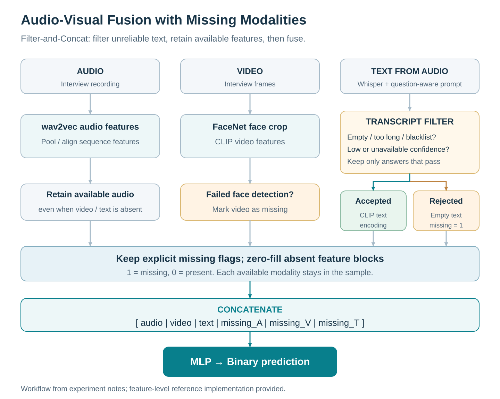
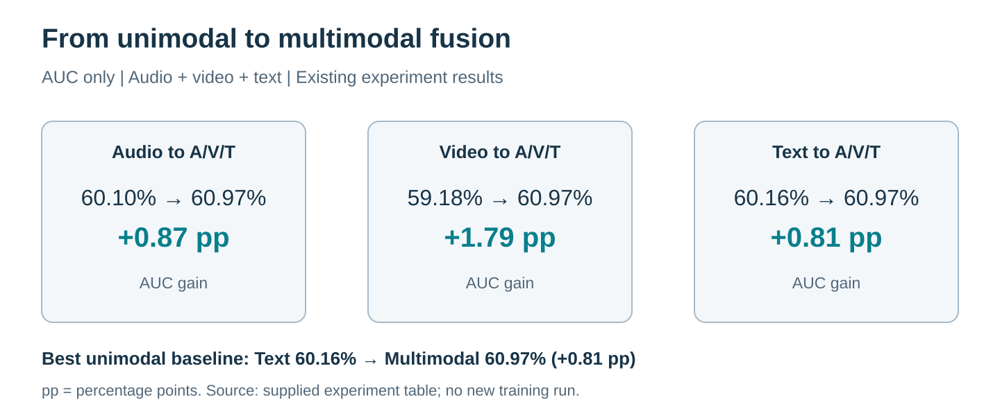

# Audio-Visual Fusion with Missing Modalities

### How can we combine audio, video and text when some inputs are missing or unreliable?

**Filter unreliable transcripts, keep missingness explicit, and concatenate the available modality features.** This project explores multimodal learning for depression-related interview data, with two focuses: the **filtering process** and a **multimodal-versus-unimodal comparison** under observed missingness.

## 1. Filtering and fusion workflow



The diagram summarizes the workflow in the supplied experiment notes. **Filter-and-Concat** is a descriptive name for this repository's filtering-plus-concatenation pipeline.

- **Audio:** extract wav2vec features; the recorded experiment pads sequences to length 208.
- **Video:** detect/crop faces with FaceNet, then extract CLIP features. Failed face detection produces missing video features.
- **Text:** transcribe audio with Whisper using a question-aware prompt: retain only clearly heard answers, without guessing. Reject empty text, overly long text, blacklist matches or low-confidence output before CLIP text encoding.
- **Missingness:** retain explicit flags (`1 = missing`, `0 = present`). In the feature-level example, zero-fill absent feature blocks and append A/V/T missing flags before an MLP classifier. Available audio is retained when video or text is absent.

The supplied ASR gate uses a maximum of 50 characters, average token log probability ≥ −1.0, and a configurable blacklist. These are filtering heuristics, not guarantees that a transcript is correct. The experiment notes represent rejected text as empty, while the supplied SSL script additionally supports optional sample-level hard filtering.

## 2. Reported comparison



| Modality | AUC (%) | ACC (%) | F1 (%) |
| --- | ---: | ---: | ---: |
| Audio | 60.10 | 74.34 | 48.72 |
| Video | 59.18 | 74.70 | **51.31** |
| Text | 60.16 | **81.28** | 44.83 |
| **Filter-and-Concat (A/V/T)** | **60.97** | 74.44 | 24.93 |

Fusion has the highest recorded **AUC: 60.97%, +0.81 percentage points over the best unimodal AUC (text)**. Accuracy and F1 do not improve. These are descriptive results from the supplied experiment table; statistical significance was not reported.

**Experimental context.** The notes describe a binary task that merges mild and severe cases into a positive class, natural missingness from failed face detection or filtered transcripts, attention aggregation, an MLP classifier, cross-entropy loss and 1.7× resampling. The table does not specify the split, metric averaging, uncertainty or modality-specific resampling settings. It is not a controlled missing-rate ablation and does not establish a before/after filtering benefit. The values are transcribed in [reported_metrics.csv](results/reported_metrics.csv), not generated by a new training run.

## Code

```text
filtering.py                    Transcript acceptance rules and rejection reasons
fusion.py                       Zero-fill + concatenate features and missing flags
fusion_head.py                  Minimal PyTorch binary MLP
demo.py                         Synthetic example without patient data
tests/test_core.py              Filtering and missing-feature checks
research/multimodal_ssl_train.py Original ASR-gated audio-video SSL research script
results/reported_metrics.csv    Values transcribed from the experiment table
docs/assets/                   Workflow and result figures (SVG)
```

### Run the small example

```bash
python -m pip install numpy
python demo.py
python -m unittest discover -s tests -v
```

This demonstrates missing-feature handling without downloading a model or dataset. Features must already be pooled into aligned `[N, D]` matrices; the A/V/T missingness array has shape `[N, 3]`.

For a trainable classification head, install `requirements.txt` and use:

```python
import torch
from fusion import build_fusion_features
from fusion_head import ConcatClassifier

# audio, video, text: aligned pooled feature matrices
# missing: [N, 3], in audio/video/text order; 1 means missing
features = build_fusion_features(audio, video, text, missing)
model = ConcatClassifier(input_dim=features.shape[1])
logits = model(torch.from_numpy(features))  # [N, 2]
```

The root-level code is a compact reference example. The original SSL script is retained separately and requires its project-local loaders and model helpers; see [research/README.md](research/README.md). It trains audio-video alignment and is not the complete supervised A/V/T experiment behind the table. Raw interviews, transcripts, participant labels, pretrained weights and trained checkpoints are not included.

To regenerate the figures, install Pillow and run `python docs/build_figures.py` (the renderer currently uses the macOS Arial font paths).
